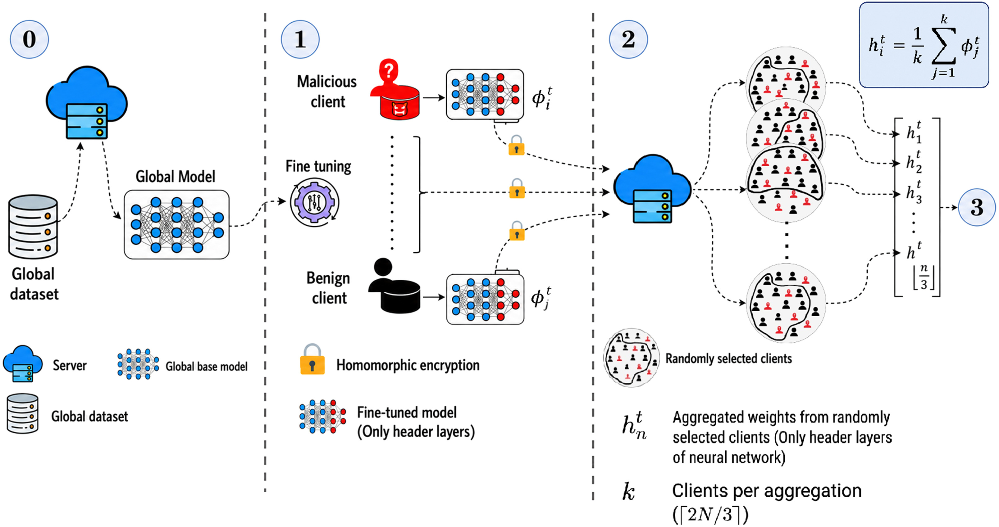
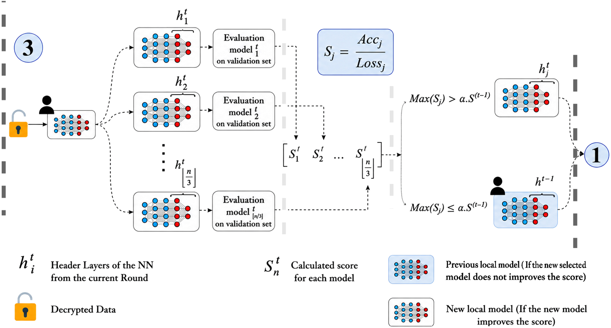

# FedBagSafe: Bagged Adaptive Selection and Fail-Safe Aggregation for Robust, Privacy-Preserving, and Personalized Federated Learning

<p align="center">
  <a href="https://doi.org/10.1016/j.compeleceng.2026.111669">
    
  </a>
  <a href="https://www.python.org/">
    
  </a>
  <a href="https://pytorch.org/">
    
  </a>
  <a href="https://www.pytorchlightning.ai/">
    
  </a>
  <a href="https://github.com/OpenMined/TenSEAL">
    
  </a>
  <a href="LICENSE">
    
  </a>
</p>

**FedBagSafe** is an open-source PyTorch framework for **Byzantine-robust and privacy-aware personalized federated learning (FL)** under non-IID data. It combines bagging, client-side model selection, and fail-safe rollback to defend against malicious updates. Optional homomorphic encryption enhances privacy. Across four benchmarks, it outperforms six baselines and reduces attack success by 92.5%. This is the official implementation of the [*Computers and Electrical Engineering*](https://doi.org/10.1016/j.compeleceng.2026.111669) article, building on the design of [**LightFedSelect** (Razavi et al., IEEE ICCKE 2025)](https://doi.org/10.1109/ICCKE68588.2025.11273877).

> **Paper:** [FedBagSafe: Bagged adaptive selection and fail-safe aggregation for robust, privacy-preserving, and personalized Federated Learning](https://doi.org/10.1016/j.compeleceng.2026.111669) (*Computers and Electrical Engineering*, Elsevier, Vol. 141, 111669, 2027)

---

## Overview

Federated Learning is vulnerable to malicious client updates, statistical heterogeneity across local datasets, and server blindness under cryptographic secure aggregation. **FedBagSafe** addresses these challenges by combining **bagged multi-aggregation** on the server with **client-side model evaluation** on the edge, ensuring that candidate updates are validated locally before adoption.

The project is designed for research on **Byzantine robustness, secure aggregation, model poisoning defense, backdoor resilience, and personalized FL**. It provides modular components for Dirichlet non-IID data partitioning, head-only local training, encrypted aggregation, client-side validation, and experiment reproducibility across CIFAR-10, CIFAR-100, FashionMNIST, and FEMNIST.

<p align="center">
  
</p>

*Figure 1: First phase of FedBagSafe showing server-side bagged multi-aggregation with optionally encrypted head-layer aggregation.*

<p align="center">
  
</p>

*Figure 2: Second phase of FedBagSafe showing client-side evaluation, model selection, and adaptive fail-safe acceptance.*

---

## Method Summary

FedBagSafe operates in two core stages during each communication round:

1. **Server-Side Bagged Multi-Aggregation (with Frozen Backbone):** Foundational feature-extractor layers ($\psi$) remain frozen after initialization, while only the trainable head layers ($\phi$) are updated locally and (optionally) encrypted under CKKS. The server samples $M = \lfloor N/3 \rfloor$ randomized, overlapping client subsets of size $K = \lceil 2N/3 \rceil$ and computes $M$ candidate head aggregates, preventing strict Byzantine majority control within sub-aggregates when $f \le \lfloor N/3 \rfloor$.

2. **Client-Side Composite Scoring & Fail-Safe Selection:** Each client evaluates the $M$ candidate models on a shared, read-only validation set ($\mathcal{T}_{\text{global}}$) using an accuracy-over-loss composite score:

$$
S_i^{(t),j} = \frac{\text{Acc}_{\mathcal{T}_{\text{global}}}(\psi, \phi_i^{(t),j})}{\text{Loss}_{\mathcal{T}_{\text{global}}}(\psi, \phi_i^{(t),j}) + \epsilon}
$$

Each client selects the candidate maximizing its composite score, $`j_i^* = \arg\max_j S_i^{(t),j}`$, and accepts the update only if it satisfies the multiplicative fail-safe threshold:

$$
S_i^{(t)} \ge \tau \cdot S_i^{(t-1)}
$$

Otherwise, the client rejects the update and rolls back to its previous local model state $\phi_i^{(t-1)}$.

---

## Key Features

- **Bagged Multi-Aggregation:** The server samples $M=\lfloor N/3\rfloor$ overlapping client subsets of size $K=\lceil 2N/3\rceil$ per round to disperse the influence of malicious updates.
- **Client-Side Self-Validation:** Each client evaluates candidate models locally via the accuracy-over-loss score to detect subtle calibration degradation caused by backdoors.
- **Adaptive Fail-Safe Rollback:** A candidate model is accepted only when it clears the decaying threshold ($\tau$), preventing performance collapse during high-intensity attack phases.
- **Head-Only Personalized FL:** Only the head layers are fine-tuned and aggregated while the backbone remains frozen, curbing representation drift under non-IID heterogeneity and reducing uplink overhead.
- **Optional Homomorphic Encryption:** Integrates TenSEAL CKKS ($n_{\text{poly}}=8192$, 128-bit security parameterization) to encrypt trainable head parameters prior to server-side summation.
- **Multi-Attack Evaluation Suite:** Built-in support for targeted label flipping, mixed backdoor trigger injection, and Gaussian model-poisoning experiments.

---

## Benchmark Results

Evaluated across **100 communication rounds** with **$N=100$ participating clients** ($f=24$ malicious clients executing interleaved label-flipping, backdoor, and model-poisoning attacks under non-IID $\text{Dir}(\alpha=1)$ partitioning), **FedBagSafe** reduces the average backdoor Attack Success Rate (ASR) by **92.5%** relative to six baseline aggregators while maintaining over **90%** mean accuracy on FashionMNIST and CIFAR-10:

| Dataset | Metric | FedBagSafe | RFA | Multi-Krum | FedAvg | Bulyan | Krum | Trimmed Mean |
| :--- | :--- | :---: | :---: | :---: | :---: | :---: | :---: | :---: |
| **FEMNIST** | Overall Accuracy ($\uparrow$) | **0.6800** | 0.5611 | 0.5725 | 0.4913 | 0.4366 | 0.5148 | 0.3887 |
| *(62 classes)* | Average Backdoor ASR ($\downarrow$) | **0.0328** | 0.4922 | 0.5223 | 0.4324 | 0.8016 | 0.3982 | 0.7500 |
| **FashionMNIST** | Overall Accuracy ($\uparrow$) | **0.9156** | 0.8928 | 0.8845 | 0.8916 | 0.8433 | 0.6919 | 0.8223 |
| *(10 classes)* | Average Backdoor ASR ($\downarrow$) | **0.0030** | 0.0163 | 0.0149 | 0.0174 | 0.0299 | 0.0696 | 0.0512 |
| **CIFAR-10** | Overall Accuracy ($\uparrow$) | **0.9026** | 0.8866 | 0.8536 | 0.8187 | 0.7653 | 0.6794 | 0.7009 |
| *(10 classes)* | Average Backdoor ASR ($\downarrow$) | **0.0115** | 0.0594 | 0.2242 | 0.4066 | 0.3943 | 0.3126 | 0.1438 |
| **CIFAR-100** | Overall Accuracy ($\uparrow$) | **0.6615** | 0.4711 | 0.4876 | 0.3984 | 0.3096 | 0.1760 | 0.2704 |
| *(100 classes)* | Average Backdoor ASR ($\downarrow$) | **0.0274** | 0.5245 | 0.5380 | 0.7205 | 0.8021 | 0.6987 | 0.6578 |

---

## Repository Structure

```text
├── config/
│   ├── config.yaml             # Master configuration file
│   └── config_parser.py        # YAML and CLI argument parser
├── data/
│   ├── dataset_loader.py       # CIFAR-10/100, FashionMNIST, FEMNIST loaders
│   ├── dataset_modes.py        # Attack mode definitions
│   └── data_utils.py           # Non-IID Dirichlet distribution tools
├── evaluation/
│   └── evaluator.py            # Model evaluation and metrics computation
├── models/
│   ├── base_model.py           # PyTorch Lightning base module
│   ├── cifar_resnet.py         # ResNet50 variant for CIFAR
│   ├── model_factory.py        # Checkpoint and architecture loading
│   ├── resnet9.py              # Generic ResNet9 architecture
│   ├── resnet9_fashionmnist.py # ResNet9 optimized for FashionMNIST
│   └── resnet9_femnist.py      # ResNet9 optimized for FEMNIST
├── security/
│   ├── encryption.py           # TenSEAL CKKS encryption context
│   └── aggregation_he.py       # Secure encrypted aggregation
├── training/
│   ├── federated_trainer.py    # Main FL loop & phase scheduler
│   ├── local_trainer.py        # Client-side training logic
│   └── aggregation.py          # Bagging & Selective uniform average
├── utils/
│   ├── logging_utils.py        # Verbose and file logging
│   ├── seed_utils.py           # Reproducibility constraints
│   └── device_utils.py         # CPU/CUDA device management
└── main.py                     # Framework Entry Point
```

---

## Installation

### 1. Clone the repository

```bash
git clone https://github.com/Spitamo/fedbagsafe.git
cd fedbagsafe
```

### 2. Install dependencies

Requires Python 3.8+.

```bash
pip install torch torchvision pytorch-lightning numpy pyyaml
```

### 3. Optional: Install TenSEAL for homomorphic encryption

```bash
pip install tenseal
```

---

## Usage

FedBagSafe can be executed through `main.py`. Configuration can be provided through the YAML file, command-line arguments, or both, where CLI arguments override YAML settings.

### Standard Runs

```bash
# Run using the default configuration file
python main.py --config config/config.yaml

# Override dataset and enable homomorphic encryption
python main.py --dataset fashionmnist --enable-he

# Run CIFAR-10 with a custom round count and disabled HE
python main.py --dataset cifar10 --disable-he --n-rounds 50
```

### Configuration Example

```yaml
dataset:
  mode: fashionmnist
federated:
  n_nodes: 100
  n_rounds: 100
attack:
  enabled: true
  malicious_clients: 24
encryption:
  enabled: false
  type: CKKS
```

---

## Experimental Phases

FedBagSafe is evaluated through a 6-phase adversarial stress-test schedule over 100 communication rounds:

1. **Phase 1 — Stable Initialization (Rounds 1–10):** Benign training to establish a stable baseline.
2. **Phase 2 — Gradual Attack Introduction (up to Round 25):** Intermittent, low-intensity adversarial activity.
3. **Phase 3 — Moderate Attack Phase (up to Round 50):** Attacks of moderate frequency and strength.
4. **Phase 4 — High-Intensity Attacks (up to Round 75):** Sustained, strong adversarial presence.
5. **Phase 5 — Stress Test (up to Round 85):** Concentrated sequence of attacks to probe resilience.
6. **Phase 6 — Recovery and Validation (up to Round 100):** Reduced or absent attacks to allow stabilization and final evaluation.

The framework tracks **Classification Accuracy**, **Cross-Entropy Loss**, **Composite Robustness Score ($S$)**, and **Backdoor Attack Success Rate (ASR)** during evaluation.

---

## Reproducibility

The framework includes utilities for seed control and logging to support reproducible experiments. For reliable comparisons, maintain identical Dirichlet non-IID data splits ($\alpha=1$), pre-trained backbone checkpoints, synchronous attack schedules, client counts ($N=100$, $f=24$), and calibrated fail-safe thresholds ($\tau$) across runs.

---

## Citation

If you use **FedBagSafe** or this codebase in your research, please cite the *Computers and Electrical Engineering* article:

```bibtex
@article{ATANI2027111669,
  title = {FedBagSafe: Bagged adaptive selection and fail-safe aggregation for robust, privacy-preserving, and personalized Federated Learning},
  journal = {Computers and Electrical Engineering},
  volume = {141},
  year = {2027},
  issn = {0045-7906},
  doi = {10.1016/j.compeleceng.2026.111669},
  url = {https://www.sciencedirect.com/science/article/pii/S0045790626007391},
  author = {Reza Ebrahimi Atani and Seyed Saeed Razavi and Soroosh Dadashi Pakdeh and Arsalan Vasegh Rahimparvar}
}
```

---

## Contact & License

For questions regarding the implementation or reproducing the experiments, please open an issue or contact the maintainer, Seyed Saeed Razavi, at `razavi.saeed@outlook.com`.

This project is licensed under the MIT License. See the [LICENSE](LICENSE) file for details.